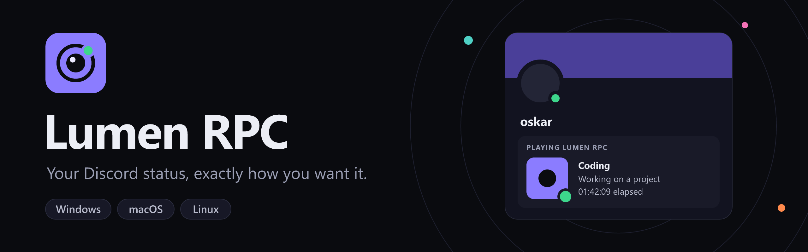
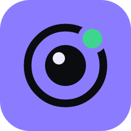

<p align="center">
  
</p>

<p align="center">
  <a href="https://github.com/OskarTrzaskawka/LumenRPC/releases/latest"></a>
  <a href="https://github.com/OskarTrzaskawka/LumenRPC/releases"></a>
  <a href="https://github.com/OskarTrzaskawka/LumenRPC/stargazers"></a>
  <a href="https://github.com/OskarTrzaskawka/LumenRPC/actions/workflows/ci.yml"></a>
  <a href="LICENSE"></a>
</p>

<p align="center">
  
  
  
  
  
</p>

<p align="center">
  <b>Lumen RPC</b> sets a fully custom Discord Rich Presence — with a live preview, seven timer modes,<br>
  automations that react to the apps you run, a weekly schedule and ready-made templates.
</p>

<p align="center">
  <a href="#download"><b>Download</b></a> ·
  <a href="#features"><b>Features</b></a> ·
  <a href="#getting-a-client-id"><b>Client ID</b></a> ·
  <a href="#building-from-source"><b>Build</b></a>
</p>

---

## Download

Lumen RPC runs on **Windows 10 and 11** (64-bit). Pick one of two installers:

| Installer | What it does | Download |
| --- | --- | --- |
| **Full** | Everything inside, installs offline. Also available as `.msi`. | [`Lumen.RPC_x64-setup.exe`](https://github.com/OskarTrzaskawka/LumenRPC/releases/latest) |
| **Lite** | A small setup app that downloads and installs the newest version from this repository. | [`LumenRPC-Lite-Setup-windows-x64.exe`](https://github.com/OskarTrzaskawka/LumenRPC/releases/latest/download/LumenRPC-Lite-Setup-windows-x64.exe) |

> [!NOTE]
> The builds are not code-signed yet. If Windows SmartScreen appears, click **More info → Run anyway**.

## Features

| | |
| --- | --- |
| **Bring your own app** | Paste the Application ID from the Discord Developer Portal; Lumen shows the app’s name, icon and your uploaded images. |
| **Game & app finder** | Search all 25,000+ games Discord recognises plus popular apps (YouTube, Twitch, Netflix, Apple Music, VS Code, GitHub, Figma…) and show “Playing Minecraft” with the real name and icon — no Developer Portal needed. |
| **Custom app name** | Override the name Discord shows (“Playing …”) per profile — no need to rename the app in the Developer Portal. |
| **Studio editor** | Playing / Listening / Watching / Competing, what the member list shows, details and state with optional links, large and small images with hover text, party size and two buttons — with a live preview. |
| **7 timer modes** | No timer · since app start · since the status was set · **your local time** · custom start date · countdown · “started X minutes ago”. |
| **Variables** | `{time}`, `{date}`, `{day}` and `{profile}` refresh on their own. |
| **Automations** | “When `code.exe` is running → show *Coding*”, “idle for 10 minutes → show *AFK*”. |
| **Weekly schedule** | Plan statuses on a timeline; manual switches still win for a while. |
| **Templates** | Start from ready-made statuses, import and export profiles as JSON. |
| **Quick switch** | `Ctrl+K` inside the app, `Ctrl+Shift+Space` from anywhere. |
| **Runs quietly** | Tray icon, start with your computer, reconnects when Discord restarts. |

## Getting a Client ID

1. Open the [Discord Developer Portal](https://discord.com/developers/applications) and click **New Application**. The name you choose appears after “Playing”.
2. Copy the **Application ID** from *General Information*.
3. Optional: upload images under **Rich Presence → Art Assets** — Lumen lists them automatically.
4. Paste the ID into Lumen RPC and click **Connect**. Keep the Discord desktop app running.

## Building from source

Requirements on Windows: Node.js 20+, Rust (stable, via [rustup](https://rustup.rs)) and Microsoft C++ Build Tools (see the [Tauri prerequisites](https://tauri.app/start/prerequisites/)).

```bash
npm install
npm run tauri dev        # run the app
npm run tauri build      # full installers (.exe + .msi) → src-tauri/target/release/bundle
npm run build:demo       # browser demo with a simulated Discord connection
node scripts/render-branding.mjs   # re-render logo, banners and installer artwork

# lite installer → installer/src-tauri/target/release/LumenRPC-Lite-Setup.exe
cd installer && node ../node_modules/@tauri-apps/cli/tauri.js build --no-bundle
```

Releases can also be built by GitHub Actions: push a tag such as `v0.2.0` and both Windows installers are attached to a draft release.

<details>
<summary><b>Project layout</b></summary>

| Path | What it is |
| --- | --- |
| `src-tauri/src/rpc.rs` | Discord IPC client (named pipe, auto-reconnect) |
| `src-tauri/src/system.rs` | Running apps and idle time for automations |
| `src-tauri/src/lib.rs` | Tray, commands and plugins |
| `src/lib/activity.ts` | Presence payload, timer modes and validation |
| `src/lib/engine.ts` | Picks the live profile (manual / automation / schedule) and sends it |
| `src/pages/` | Connect, Studio, Automations, Schedule, Templates, Settings |
| `installer/` | Lite web installer |
| `branding/` | Logo, banners and installer artwork (SVG sources + rendered PNG) |

</details>

## Star history

<a href="https://star-history.com/#OskarTrzaskawka/LumenRPC&Date">
  <picture>
    <source media="(prefers-color-scheme: dark)" srcset="https://api.star-history.com/svg?repos=OskarTrzaskawka/LumenRPC&type=Date&theme=dark">
    
  </picture>
</a>

If Lumen RPC is useful to you, a ⭐ helps other people find it.

## License

[MIT](LICENSE)

---

<p align="center">
  <br>
  Made by <a href="https://github.com/OskarTrzaskawka"><b>Oskar Trzaskawka</b></a>
</p>
